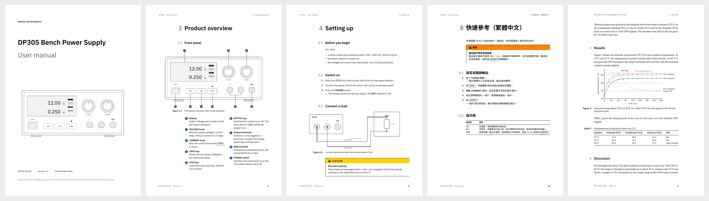
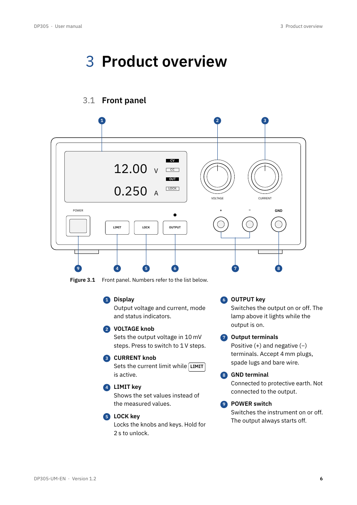
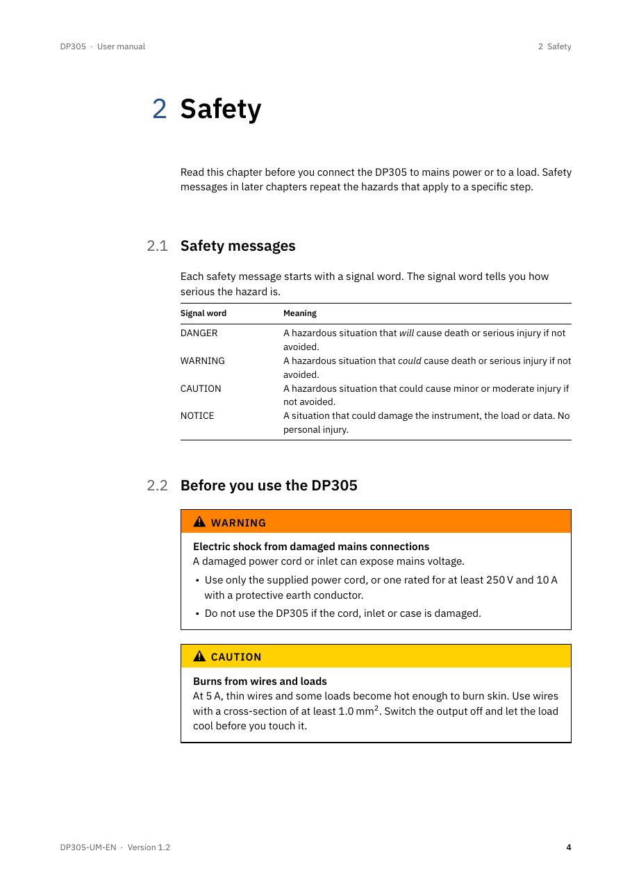
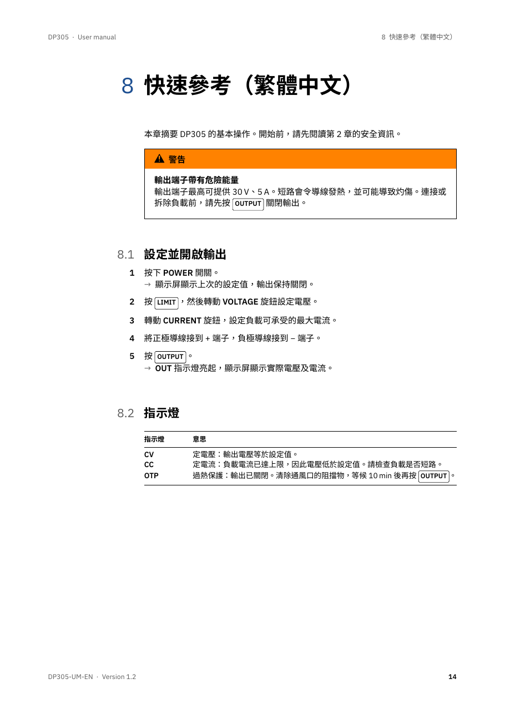
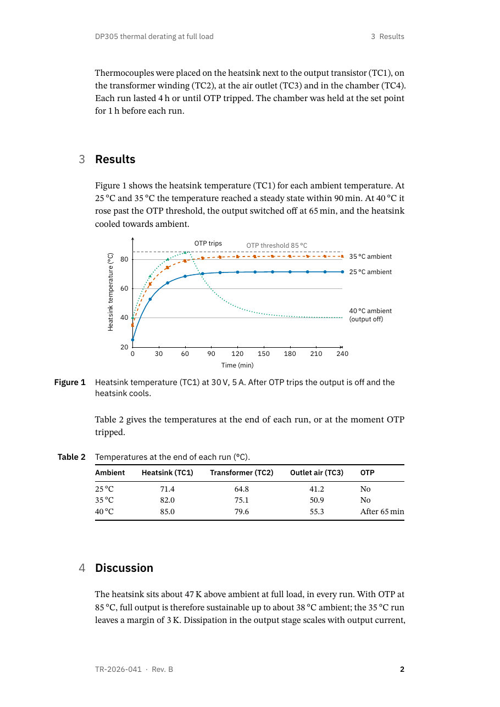

# Plain Docs

An agent skill and a LaTeX class for documents that read and look like a
publisher made them: user manuals, equipment guides, test reports and memos,
in 25 languages.



- **LaTeX only.** Everything compiles with LuaLaTeX through `plaindoc.cls`, a
  KOMA-Script class that holds the grid, type scale, colours and components.
- **A fixed font for every language.** STIX Two and IBM Plex for Latin,
  Greek and Cyrillic text, Noto CJK in the right regional build for Hong Kong,
  Taiwan, mainland China, Japan and Korea, and Noto or Plex faces for Arabic,
  Hebrew, Devanagari and Thai. Missing fonts fall back down a declared chain
  and are reported.
- **Colour by role.** Black text, one accent for navigation and figure
  callouts, ANSI Z535 / ISO 3864 colours only inside safety messages,
  Okabe–Ito colours only in charts. No tinted boxes, gradients or coloured
  headings.
- **Built for instructions.** Hanging step numbers with results, ANSI Z535.6
  safety messages, technical drawings with numbered callouts and matching
  legends, booktabs tables, locale-aware units.
- **Checked.** A linter for source-level slop and a build checker for missing
  glyphs, overfull lines, unresolved references, font embedding and required
  text, plus page renders for visual review.

## Examples

| File | What it shows |
| --- | --- |
| [examples/manual/dp305-manual.pdf](examples/manual/dp305-manual.pdf) | 14-page equipment manual: cover, safety chapter, front and rear panel drawings with callouts, procedures, troubleshooting, specifications, Hong Kong Chinese quick reference |
| [examples/report/dp305-thermal-report.pdf](examples/report/dp305-thermal-report.pdf) | 3-page test report: summary, method, chart, tables, footnote, references |
| [examples/memo/datasheet-change-memo.pdf](examples/memo/datasheet-change-memo.pdf) | One-page memo |
| [examples/specimen/language-specimen.pdf](examples/specimen/language-specimen.pdf) | One instruction in 20 languages with their fixed fonts, numbers and quotes |
| [examples/specimen/cjk-specimen.pdf](examples/specimen/cjk-specimen.pdf) | Hong Kong, Taiwan and mainland Chinese, Japanese and Korean, with mixed text |

The DP305 and Orrin Instruments are fictional; the drawings are original TikZ.

| | |
| --- | --- |
|  |  |
|  |  |

## Install

**As a skill.** Copy `skills/plain-docs` so that `SKILL.md` sits directly in
the skill folder:

- Claude Code: `~/.claude/skills/plain-docs/` (personal) or
  `.claude/skills/plain-docs/` in a project.
- Claude apps: zip the `plain-docs` folder and upload it as a custom skill.
- Other agents that read `SKILL.md` skills: the agent's skill directory
  (`agents/openai.yaml` carries display metadata for Codex).

**The toolchain.** TeX Live 2023 or newer (or MiKTeX) with LuaLaTeX,
latexmk and biber; Poppler (`pdftoppm`, `pdffonts`, `pdftotext`); Python 3.8+;
Pillow (optional, for contact sheets). Fonts and per-platform commands are in
[references/fonts.md](skills/plain-docs/references/fonts.md). On Debian or
Ubuntu:

```sh
sudo apt install texlive-luatex texlive-latex-extra texlive-fonts-extra \
  texlive-lang-chinese texlive-lang-japanese texlive-lang-other \
  texlive-lang-arabic texlive-lang-cyrillic texlive-lang-european \
  texlive-science texlive-pictures texlive-bibtex-extra biber latexmk \
  fonts-noto-cjk fonts-noto-core fonts-ibm-plex poppler-utils
```

## Use

Ask the agent for the document, for example:

```text
Use plain-docs to write a user manual for this instrument from the attached
notes. English, with a Traditional Chinese (Hong Kong) quick-reference chapter.
```

Or work with the class directly:

```sh
cp skills/plain-docs/templates/manual.tex my-manual.tex
python3 skills/plain-docs/scripts/lint.py my-manual.tex
python3 skills/plain-docs/scripts/build.py my-manual.tex --render out/
```

```latex
\documentclass[type=manual, lang=en-GB, otherlangs={zh-HK}]{plaindoc}
\pdset{brand={…}, title={…}, subtitle={User manual}, docid={…}, version={…}, date={…}}
\begin{document}
\maketitle
\tableofcontents
\chapter{Setting up}
\begin{safety}{caution}[Reversed polarity]
Many loads are damaged when + and − are swapped. Check the polarity first.
\end{safety}
\begin{steps}
\item Press \key{OUTPUT}.
      \result{\ui{OUT} lights.}
\end{steps}
\begin{lang}{zh-HK} ... \end{lang}
\end{document}
```

## Repository

```text
skills/plain-docs/
  SKILL.md              workflow and rules for the agent
  latex/plaindoc.cls    the class
  templates/            manual, report, memo
  scripts/              build.py, check.py, lint.py
  references/           fonts, languages, colour, layout, writing, verification, sources
examples/               sources and PDFs of the examples, page previews
tests/                  python3 -m unittest discover -s tests -v
```

## What has been tested

On Ubuntu 24.04 with TeX Live 2023: all five examples build with zero errors
from `check.py` (the language specimen reports one intended warning: no
Portuguese (Portugal) signal words), every page was rendered and reviewed,
and the 13 unit and integration tests pass. Not yet tested: MiKTeX, macOS,
TeX Live 2025 tagged-PDF output, and PDF/UA validation.

LuaTeX-ja is memory-hungry with large CJK fonts: the example manual with one
CJK region peaks at about 3.7 GB; see the fonts reference.

## Licence

MIT for the class, scripts, templates and text. The fonts are under the SIL
Open Font License and are not redistributed here. Standards cited in the
references are the property of their publishers.
