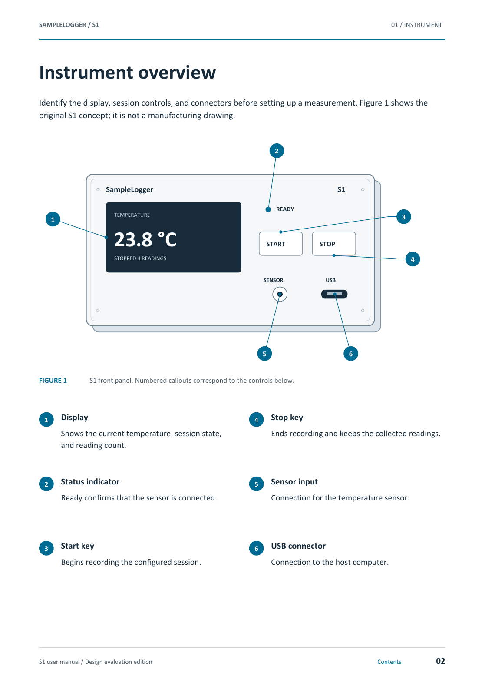

# Plain Docs

A reusable agent skill for professional English and Chinese documents: deliberate page design, useful technical figures, clear writing, and checks for broken text.

It is intended for technical equipment manuals, SOPs, reference guides, and reports. It combines document design, editorial work, and verification, plus a small read-only checker. It does not need an API key, install hooks, or change your agent's global rules.



[View the eight-page technical manual](examples/technical-manual.pdf): an annotated instrument view, connection diagram, schematic interface, export procedure, specifications, and Traditional/Simplified Chinese quick references. The product, artwork, and interface are original fictional examples. This is not a tagged accessibility example.

The earlier [three-page specimen](examples/manual-specimen.pdf) remains as a basic typography and text-integrity example. It is not the design target for a professional equipment manual.

## What it changes

- Plans page types, a grid, typography, color roles, navigation, and figures before production.
- Uses equipment callouts, procedure/figure pairs, specification tables, and appropriate page layouts.
- Uses clear headings, usable instructions, and source-grounded facts.
- Preserves Chinese, punctuation, units, and meaningful technical symbols.
- Checks actual font coverage, export text, and the final rendered pages.
- Requires honest reporting when a document cannot be fully verified.

The defaults respect an explicit user template, required safety formatting, and brand requirements. Read the [skill](skills/plain-docs/SKILL.md), the [manual design guide](skills/plain-docs/references/manual-design.md), and the [manufacturer reference study](DESIGN-REFERENCES.md). The [initial investigation](RESEARCH.md) explains the text-integrity work. Inspired by Ponytail's preference for necessary work; no Ponytail code or hooks are bundled. Simplicity should remove clutter, not useful design.

## Install in Codex

Copy the complete `skills/plain-docs` folder into either:

- `.agents/skills/plain-docs` within a project, for project use.
- `~/.agents/skills/plain-docs`, for personal use.

The resulting folder must contain `SKILL.md` directly, with its `references`, `scripts`, and `agents` subfolders alongside it. Avoid nesting another `plain-docs` directory inside it. If it does not appear, restart Codex. See the [official discovery documentation](https://learn.chatgpt.com/docs/build-skills).

Then use:

```text
Use $plain-docs to design a professional technical equipment manual from these notes.
Plan the page layouts and include useful annotated figures and navigation.
Use Traditional Chinese and preserve all product facts and technical symbols.
Verify the text, figures, links, and every rendered page before delivery.
```

For another skill-capable agent, use that host's supported skill location or provide `SKILL.md` and its references directly. The instructions are portable Markdown; automatic discovery and tool execution depend on the host. This package has not been tested across other agents.

## Optional checker and sample builder

The instructions themselves have no Python dependency. To run every included helper, use Python 3.10+ and install the packages into a virtual environment:

```sh
python -m venv .venv
# Activate .venv using your shell's normal activation command.
python -m pip install -r requirements.txt
python -m unittest discover -s tests -v
```

Examples from the repository root:

```sh
python skills/plain-docs/scripts/preflight.py source document.txt
python skills/plain-docs/scripts/preflight.py source chinese-body.txt --font /path/to/chinese.ttf
python skills/plain-docs/scripts/preflight.py pdf document.pdf --expect examples/critical-strings.txt
```

Use your own expected-strings file for your own document; the included one is for the specimen. Each non-empty line is a critical string that must survive extraction. See [verification](skills/plain-docs/references/verification.md) for exit codes, font collections, rendering commands, and limitations.

The sample builder consumes [manual-source.json](examples/manual-source.json). It requires explicit regular and bold TrueType fonts for Latin, Traditional Chinese, and Simplified Chinese. TTC collection index 0 is supported by this example. Other font formats may require another exporter. Example in Windows PowerShell, if these fonts are present and embedding is permitted:

```powershell
python examples/build_sample.py --out work/manual-specimen.pdf `
  --latin-regular C:/Windows/Fonts/calibri.ttf `
  --latin-bold C:/Windows/Fonts/calibrib.ttf `
  --tc-regular C:/Windows/Fonts/msjh.ttc `
  --tc-bold C:/Windows/Fonts/msjhbd.ttc `
  --sc-regular C:/Windows/Fonts/msyh.ttc `
  --sc-bold C:/Windows/Fonts/msyhbd.ttc
```

For the designed technical manual, run `examples/build_technical_manual.py` with the same font arguments and an output path such as `work/technical-manual.pdf`. Add `--manifest work/text-frames.json` to record text-frame positions for review. Its source concept and page plan are in [technical-manual-brief.md](examples/technical-manual-brief.md). The builder uses measured paragraphs inside deliberately composed page regions, fails on defined text-frame overflows, and draws the original equipment figures as vectors.

No font files are distributed. The examples check font coverage before export; the technical builder routes missing symbols to an explicitly checked fallback face. They are specimen builders, not general Word converters or complete Chinese typesetting engines. For arbitrary source material, follow the skill and use an appropriate authoring tool.

## Verification scope

The checker cannot judge prose quality, prove facts, detect every overlap, recover lost source text, or certify PDF accessibility. A zero-error report still requires visual review. Suspicious text can be an intentional literal example, so findings need context. The helper never repairs or overwrites input files.

The initial sample, the eight-page designed manual, and nine checker tests have been exercised; see [validation](VALIDATION.md). The technical sample also checks text frames, internal links, and bookmark destinations. Word export and multi-model behavioral trials have not been completed. Proposed [evaluation scenarios](evals/scenarios.md) make future improvements testable without implying a benchmark result.

## Contributing

The included MIT license covers the original instructions, code, and example text; third-party fonts remain under their own terms. Keep the skill's instructions focused, put detailed guidance in its references, and include evidence for changes to the checker or layout workflow.

To report a defect, include a minimal non-sensitive source, the intended language, exporter and font details, and the incorrect result. Prefer a demonstrated correction over another broad rule.

## License and sources

[MIT](LICENSE). The [research notes](RESEARCH.md) link to Ponytail, Unicode, ReportLab, Adobe, Google, W3C, and typography guidance. Their websites, software, and fonts are not relicensed by this repository. Microsoft describes the distinction between font redistribution and permitted [document embedding](https://learn.microsoft.com/en-us/typography/fonts/font-faq).
